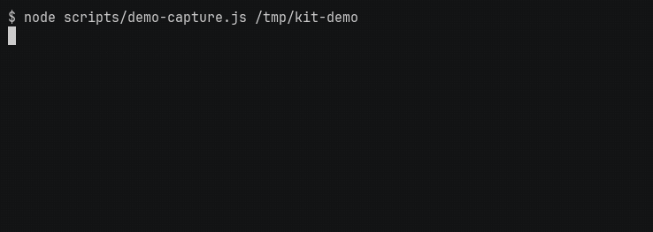

# smartclient-capture-kit



The GIF is a real run of [scripts/demo-capture.js](scripts/demo-capture.js). [fixtures/demo-member-roster.html](fixtures/demo-member-roster.html) is made-up member data. [fixtures/demo-cover-unverifiable.html](fixtures/demo-cover-unverifiable.html) forces the cover to opacity 0, and the kit refuses to save. Regenerate it with `scripts/record-demo.sh` (asciinema, agg, and ffmpeg).

Playwright screenshot capture with fail-closed PHI redaction.

It is for the writer producing the UI figures for a release of an Isomorphic SmartClient application, against an environment other people are using, where the screens contain data that must not be published.

A PNG is written only after the cover is verified, and mutating clicks are cancelled in the page. Both ship on. `CAPTURE_ALLOW_WRITES=1` is what disarms the guard.

## Quickstart

Node 20.9 or newer. That floor is `engines` in `package.json`, and it is sharp's requirement.

```bash
git clone https://github.com/pinklightultra/smartclient-capture-kit
cd smartclient-capture-kit
npm install
npx playwright install chromium
npm run smoke
```

`npm run smoke` runs `node scripts/smoke-test.js`. The smoke test uses no application, no credentials, and no network. It builds its own page.

Credentials go in `.env`, which is gitignored. Hosts go in `capture.config.json`. `lib/` does not contain a URL.

```bash
npm run setup                              # writes .env as CAPTURE_USER and CAPTURE_PASS
npm run setup -- --add-env                 # adds a named host under environments
npm run setup -- --test staging            # logs in with the guard forced on and confirms the app loads
npm run capture -- --env staging --modules login,home,admin
```

`npm run capture` runs `node run-modules.js`. `npm run setup` runs `node setup.js`. The `--` is required: `npm run capture --list` runs the script with no arguments, so it prints its usage text and exits 1. Prefer `--env` to `--url`, so the hostname stays out of shell history.

## Output

With no environment configured, `npm run capture -- --list` prints the modules in `readdir` order of `modules/`:

```text
Available modules:

  admin        Admin section: tab navigation, Main/Access/UM/Compliance/CM views (requires: login)
  home         My Cases home screen: portlets, queue counts, toolbar (requires: login)
  login        Login flow: auth page, credentials entry, post-login landing
```

This is what `npm run smoke` printed. The script writes `(1 regions)` as it stands. "Client" is the first entry in `redaction.columnLabels`.

```text
PASS redaction (2 regions)
PASS safeShot covers "Client" (1 regions)
PASS safeShot refuses an uncoverable "Client" and writes no file
```

Output goes to `screenshots/<environment>/<YYYY-MM-DD>/`, plus a `capture-manifest.json` of every file written. A module run logs this line only after `installClickGuard()` returns true, then one line per file, `📸 <module>-<name>.png (N region(s) covered)`:

```text
🛡️  READ-ONLY guard active (Save/Submit/Confirm/Apply/Delete clicks blocked)
```

## Documentation

- [Install](docs/install.md). Node, Chromium, `.env`, and adding a host.
- [Capture](docs/capture.md). Modules, the click guard, and when a PNG is written.
- [Three ways a finished run is still wrong](docs/when-a-run-is-wrong.md). A mask that ate the click, a run that continued, a figure you still cannot publish.
- [Review what moved](docs/diff.md). `npm run diff`.
- [Mark up the figure](docs/annotate.md). `npm run annotate`.
- [Find a screen before you script it](docs/explore.md). `npm run repl`, the failure watcher, and the synthetic table.
- [Configuration](docs/configuration.md). `capture.config.json` and the environment variables.
- [What the smoke test checks](docs/smoke-test.md). The assertions in `scripts/smoke-test.js`. CI runs that script and nothing else.
- [Limits](docs/limits.md). Shell geometry, vocabularies, and where the checks came from.

## License

MIT. See [LICENSE](LICENSE).
